# Balance

Balance is an original single-player 2D real-time strategy game. It is a tribute
to Dune II in how it plays and how it looks: a flat, near top-down battlefield, a
grid, one scarce resource, small armies. Every name, faction, piece of art, piece
of music and level in this repository is original; nothing is taken from Dune II.

> Every faction claims to seek Balance, but each defines it differently.

**Status:** milestone M6 (Enemy AI) is done and M7 (the vertical slice) is under way. The title screen
offers Play (the story missions, each with a briefing before it and a
debriefing after it), Practice (the trials and the skirmish), Settings
(volumes, scroll speed, full screen; kept between runs) and Quit. These can
be played:

- **A skirmish against the computer**, as Blue on the forest map or as Red on
  the desert map. Both sides start with a headquarters, a refinery, a
  harvester, three soldiers and 600 Orichalcum, at opposite corners, with one
  Orichalcum rock between them. The computer harvests, builds its base,
  trains soldiers and light tanks, defends, and attacks in waves, under the
  same rules as you. Destroy every enemy building and soldier to win.

- **Mission 2, "Holding the Claim"** (M7, in progress; placeholder sound and music), as Blue on a new map, River Fords: the Prince sets up a base
  by the rock, beats off Red's assault and crosses the river to destroy
  Red's camp. Base building, both heroes, and a story told as you play.
- **Mission 1, "The First Claim"** (provisional name), to a win or a loss: as
  Blue on the forest map or as Red on the desert map. Each side has four
  troops and a field commander and fights over the Orichalcum rock in the
  middle of the map. You win by holding the ring around the rock on your own
  for 45 seconds, or by destroying every enemy. The opponent follows a short
  script.
- **The harvest trial**, a practice mission with no opponent: a refinery and
  two harvesters. Send the harvesters to the rock and they earn Orichalcum on
  their own. A harvester drives out as a truck and parks its trailer; its cab
  stands up as a robot, digs, and fills the trailer; then the truck takes the
  load to the refinery. When the store is full the harvesters wait.
- **The raid trial**, the same with three soldiers of your own and three
  raiders. A harvester that is attacked unfolds and guards its trailer. If it
  is destroyed, the raiders take the Orichalcum in the trailer.

- **The base trial**, with a headquarters, a refinery, one harvester and
  some Orichalcum. Build a generator, a barracks and a workshop from the
  build menu, place them on building ground, and train soldiers, light tanks
  and more harvesters. Everything is paid for with what the harvesters bring
  in.
- **The hero trial** (M7, in progress), as Blue: the Prince and the Field
  Commander hold a base against three Red attacks. Restore (E) heals and
  repairs the units around the Prince, his Encouragement speeds up those
  near him, Mend (Q) heals one unit, and buildings can be selected and
  repaired (R). Lose a hero and the mission is lost.

See [docs/roadmap.md](docs/roadmap.md) for what comes next.

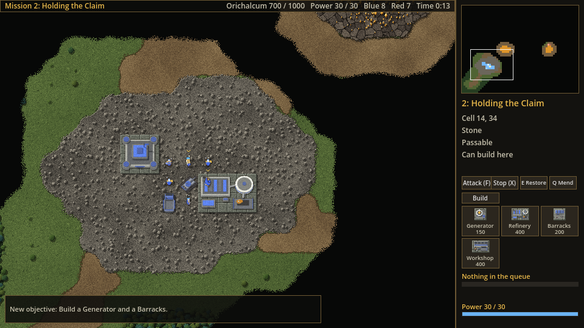
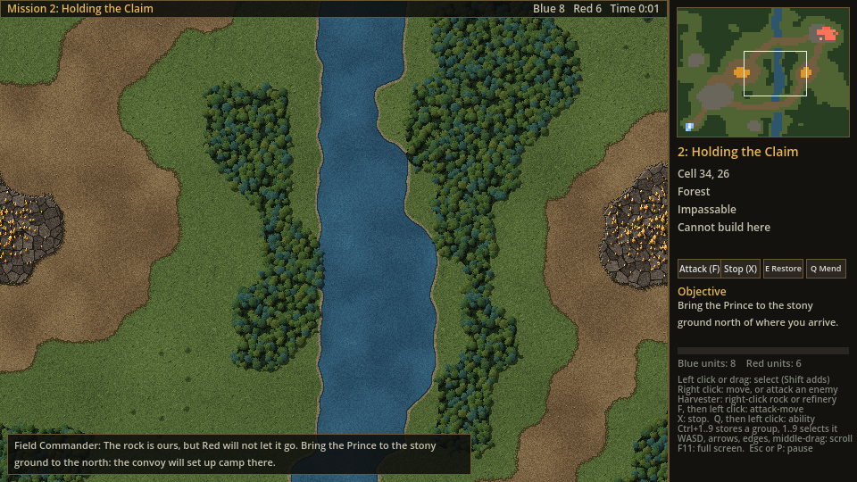
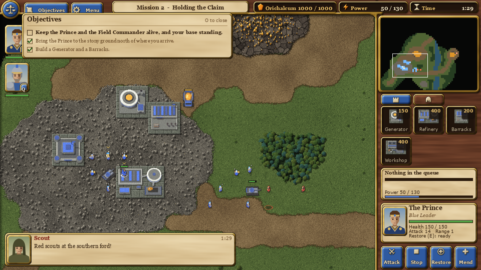
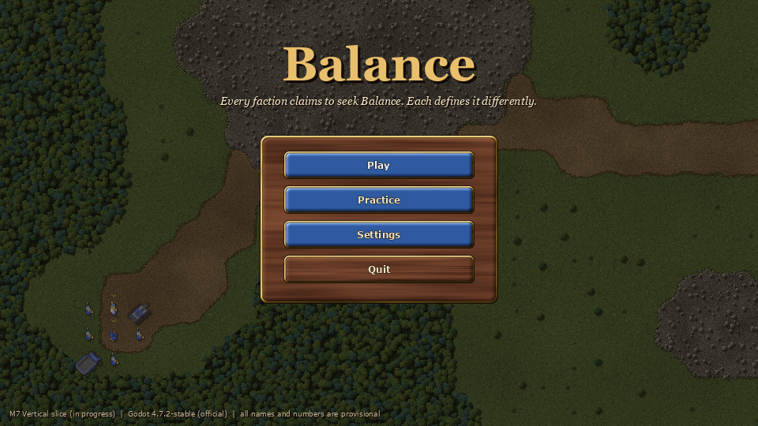
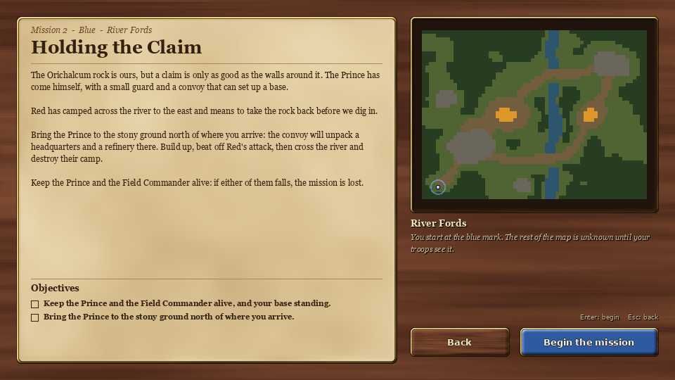
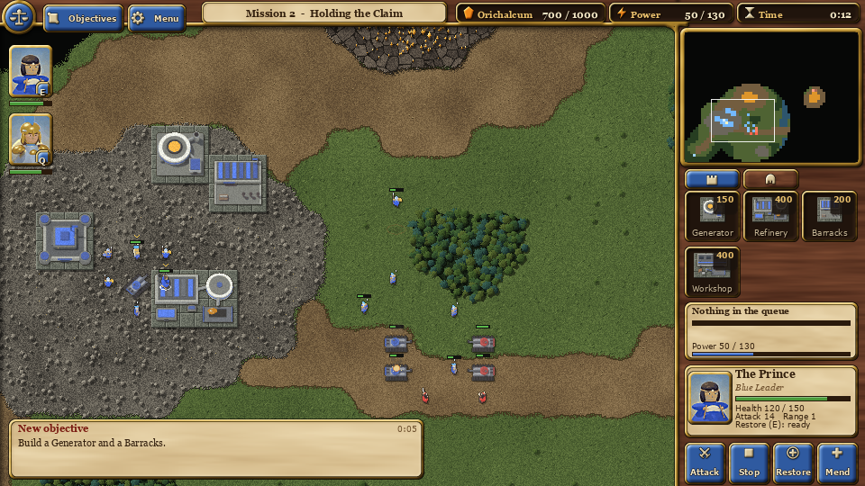

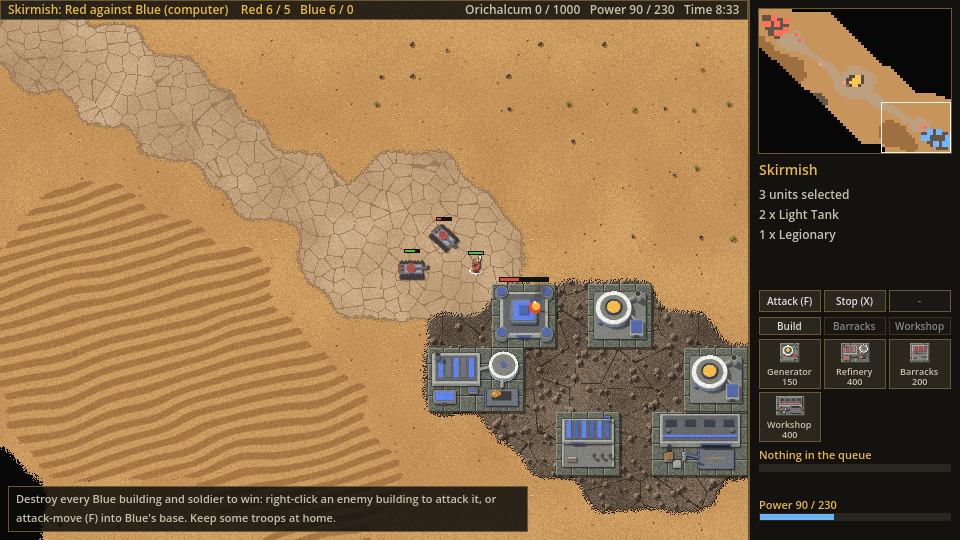
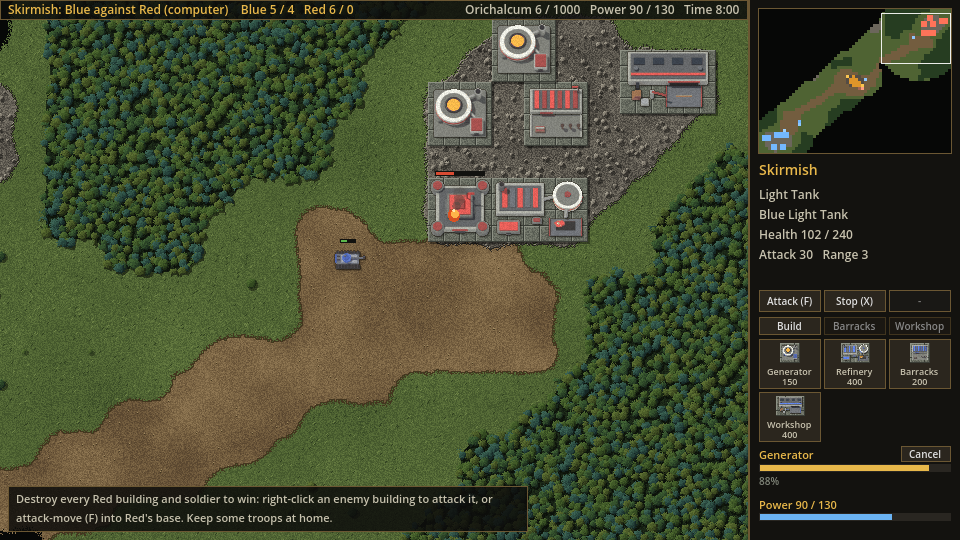

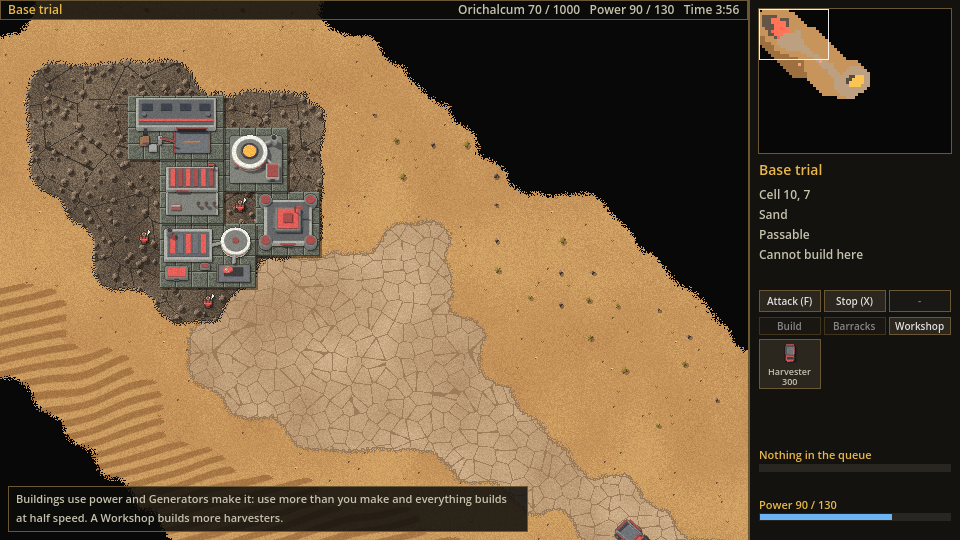
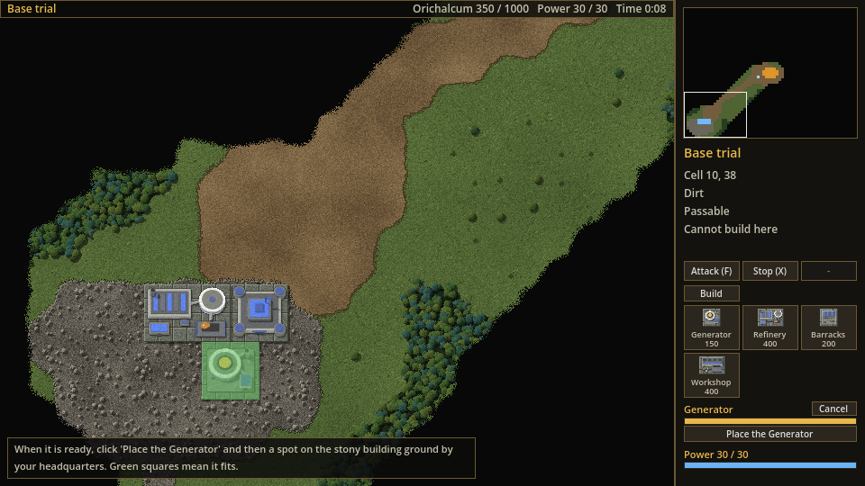

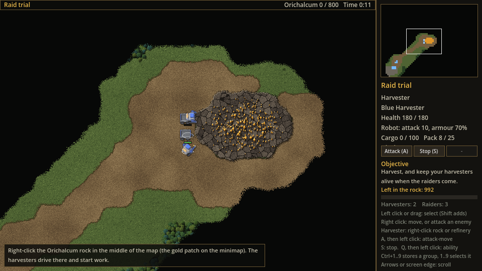
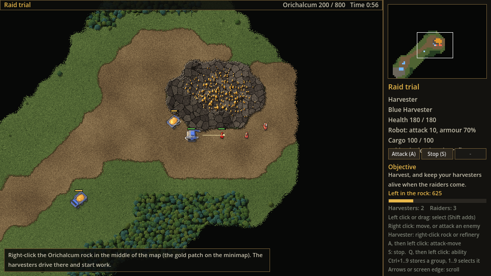
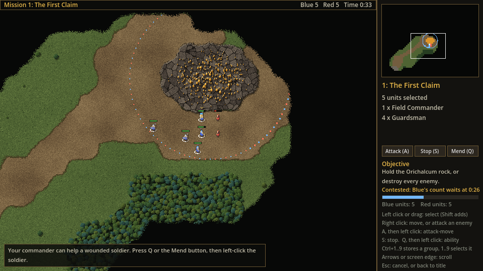

## Controls

| Input | What it does |
| --- | --- |
| Left click | Select the unit under the mouse; click empty ground to deselect |
| Left drag | Select every unit in the box |
| Shift + click or drag | Add to the selection (Shift + click on a selected unit removes it) |
| Right click on the ground | Move the selected units there |
| Right click on an enemy | Attack that enemy |
| Right click on an enemy building | Attack that building (harvesters stay out of it) |
| Right click on the Orichalcum rock, with harvesters selected | They start harvesting, and keep going on their own |
| Right click on your refinery, with harvesters selected | They unload there now |
| Right click on an enemy trailer whose harvester is destroyed | The selected units walk up to it and take its Orichalcum |
| Click in the build menu (base trial, skirmish) | Add that building or unit to the queue; Cancel takes the last one out |
| Click "Place the ...", then left click on the map | Put the finished building there (right click or Esc leaves placing) |
| F, then left click | Attack-move: walk there and fight whatever is met on the way (a click on an enemy unit or building attacks it) |
| X | Stop |
| Q, then left click on one of your units | The commander heals that unit ("Mend") |
| E | The Prince heals and repairs every unit around him ("Restore") |
| Left click on one of your buildings, then R | Select it, then repair it (R again stops) |
| Click a hero's portrait (top left) | Select that hero; double click to jump the camera to them |
| O, or the Objectives button | Open or close the list of objectives |
| Right click or Esc after F or Q | Cancel |
| Ctrl + 1 to 9 | Store the selection as a numbered group |
| 1 to 9 | Select that group; press twice quickly to jump the camera to it |
| W A S D or arrow keys, mouse at a screen edge, or drag with the middle mouse button | Scroll the map |
| F11 or Alt + Enter | Switch between full screen (the default) and a window |
| Click or drag on the minimap | Jump the camera |
| Esc or P | Pause: the game stands still and a menu offers Resume, Settings, Restart and Title screen. Esc or P again carries on |
| Esc on the debriefing | Back to the title screen |

The sidebar has buttons for attack-move, stop and the heroes' abilities, and
a card about whatever is selected. A message box at the bottom of the map
shows what the mission's characters say and, in between, explains the
controls one at a time while you play.

All names in the game ("Balance", "Orichalcum", the faction, unit, ability and
mission names) are provisional and may change, and so are all the numbers.

## Open and run

You need Godot 4.7.2 (standard build, not .NET).

- **Editor:** start Godot, choose *Import*, pick `project.godot` in this folder,
  then press F5 to run.
- **Command line** (from the repo root, with the Godot executable on your path
  or written out in full):

  ```bash
  godot --path .
  ```

  To skip the title screen (and the briefing) and start a mission directly:

  ```bash
  godot --path . -- --map=forest
  ```

  ```bash
  godot --path . -- --map=desert
  ```

  And the harvest trial (or `harvest-desert`, `raid-forest`, `raid-desert`,
  `base-forest`, `base-desert`):

  ```bash
  godot --path . -- --map=harvest-forest
  ```

  And Mission 2 (`mission-2`), the hero trial (`hero-forest`), or a skirmish against the computer (`skirmish-forest` or `skirmish-desert`):

  ```bash
  godot --path . -- --map=skirmish-forest
  ```

- **Tests** (headless; no window). Import the project once, then run the tests:

  ```bash
  godot --headless --path . --import
  ```

  ```bash
  godot --headless --path . --script res://tests/run_tests.gd
  ```

  The runner prints `TESTS PASSED` and exits with code 0 when every test passes.
  A test file is `tests/test_*.gd`; every method in it whose name starts with
  `test_` is a test.

The first time the project is opened Godot creates a `.godot/` cache folder. It
is ignored by git.

The game renders at 960x540 and is scaled up by whole numbers only (x2 fills a
1920x1080 window), so pixels stay square and sharp.

## Tools

| Tool | Version | Used for |
| --- | --- | --- |
| Godot | 4.7.2 stable | Engine and editor; game code is GDScript |
| Blender | 5.2 | Rendering unit and building sprites |
| Krita | any recent | Hand-painting and touching up art |
| Python | 3.14 with Pillow and numpy | Asset pipeline scripts and the mockup generators |
| git, GitHub CLI | any recent | Version control |

## Folders

| Folder | What it holds |
| --- | --- |
| `scenes/` | Godot scenes (`.tscn`). `main.tscn` is the scene the game starts in; `map_view.tscn` is the in-game screen. |
| `scripts/` | GDScript code. |
| `scripts/sim/` | The game simulation: grid, units, orders, combat, economy. No drawing or input code. So far: terrain, maps, units, orders, pathfinding, shroud, combat, hero abilities, the control point, missions (and in `missions/` the parts a mission is made of: sides, placed forces, objectives, triggers, conditions, hints), the scripted opponent of Mission 1, Orichalcum deposits, buildings, harvesting and storage, trailers, the raiders of the raid trial, build queues and power, destroying buildings, and the computer opponent of the skirmish. |
| `scripts/ui/` | Screens, HUD, input handling and anything else the player sees or clicks. So far: title screen, briefing, settings, terrain, unit, building, shroud, control-area and mined-out rock drawing, selection and orders, camera, minimap, the mission HUD and hints. |
| `data/` | Unit, building and terrain definitions, stored as Godot `Resource` files. So far: `terrain/` (one file per terrain type), `biomes/` (which terrain types belong together, in drawing order), `maps/`, `units/` (one file per unit type), `buildings/` (one file per building type), `abilities/` (hero abilities), `missions/` (one file per mission: its sides, forces, objectives and triggers), `hints/` (the hints' lessons, shared by missions) and `sounds/` (the sound bank: which sound each event plays). |
| `assets/sprites/` | Unit, building and effect sprites. `units/` holds the unit sprite sheets, generated by `tools/render_units.py` and `tools/make_units.py`; `buildings/` the building pictures, generated by `tools/render_units.py` and `tools/make_buildings.py`. |
| `assets/tiles/` | Terrain tiles, one folder per biome. Generated by `tools/make_tiles.py`; do not edit by hand. |
| `assets/ui/` | HUD and menu art made by `tools/make_hud.py`: the frame, panels and buttons, icons, and the heroes' portraits. |
| `assets/audio/` | Sound effects and music: placeholders made by `tools/make_sounds.py`, named in `data/sounds/sound_bank.tres` (see [docs/sound.md](docs/sound.md)). |
| `tools/` | Asset pipeline scripts (Blender and Python) that produce the files in `assets/` and the maps in `data/maps/`. Not loaded by Godot. |
| `tests/` | Headless tests, run from the command line. |
| `docs/` | Design, visual style, terrain and roadmap documents, and screenshots. Not loaded by Godot. |
| `mockups/` | Style mockups and the scripts that generated them. Reference material only, not game code or game art. Not loaded by Godot. |

`docs/`, `tools/` and `mockups/` each contain an empty `.gdignore` file, which
tells Godot to skip the folder. Empty folders hold a `.gitkeep` file so git keeps
them; delete it once the folder has real content.

## Asset pipeline

Terrain tiles, the shroud tiles and the two maps are generated by Python scripts
(Pillow and numpy needed). They use fixed seeds, so running them again gives the
same files.

```bash
python tools/make_tiles.py
```

```bash
python tools/make_maps.py
```

```bash
python tools/make_hud.py
```

```bash
python tools/make_sounds.py
```

Unit and building sprites are made in two steps: Blender renders each unit
from eight sides (and each building from one) into a scratch folder, then
Python scripts shrink the renders and pack them into sprite sheets and
building pictures.

```bash
C:\Blender\blender.exe -b --factory-startup -P tools/render_units.py -- tools/_raw
```

```bash
python tools/make_units.py
```

```bash
python tools/make_buildings.py
```

Blender must be given the output folder as a full path if it is not started
from the repo root. To render and pack only some units, name them after the
folder, for example `... -- tools/_raw commander_blue commander_red` and
`python tools/make_units.py tools/_raw commander_blue commander_red`. The
heroes' portraits are rendered the same way with `... -- tools/_raw
portraits`; then run `python tools/make_hud.py`.

After regenerating, open the project in Godot (or run the `--import` command
above) so Godot picks up the changed images. How the terrain is defined and drawn
is explained in [docs/terrain.md](docs/terrain.md); units, orders and the shroud
in [docs/units.md](docs/units.md); combat and Mission 1 in
[docs/combat.md](docs/combat.md); Orichalcum, the harvester and the refinery in
[docs/economy.md](docs/economy.md); base building, production and power in
[docs/base.md](docs/base.md); destroying buildings, the light tank, the
computer opponent and the skirmish in [docs/skirmish.md](docs/skirmish.md).

## Documents

- [docs/design.md](docs/design.md): design pillars, factions, backstory, heroes, Mission 1, open questions.
- [docs/visual-style.md](docs/visual-style.md): the approved look, with reference mockups.
- [docs/terrain.md](docs/terrain.md): terrain types, maps, and how the map is drawn.
- [docs/units.md](docs/units.md): units, the simulation tick, move orders, pathfinding, shroud, controls.
- [docs/combat.md](docs/combat.md): fighting, orders and keys, the field commander, the control point, Mission 1, and every provisional number.
- [docs/base.md](docs/base.md): the buildings and their costs, build queues, placing, production, power, the build menu and the base trial.
- [docs/skirmish.md](docs/skirmish.md): destroying buildings, the light tank, the computer opponent, the skirmish, and every provisional number.
- [docs/mission2.md](docs/mission2.md): Mission 2, its map, how it plays and its numbers.
- [docs/heroes.md](docs/heroes.md): the Prince, abilities, losing a hero, and repairing buildings.
- [docs/sound.md](docs/sound.md): the placeholder sound and music, the sound bank and how to replace a sound.
- [docs/missions.md](docs/missions.md): how a mission is made: sides, placed forces, objectives, triggers, conditions and hints.
- [docs/economy.md](docs/economy.md): deposits, the harvester, the refinery and storage, guarding and stealing trailers, the practice missions, and every provisional number.
- [docs/roadmap.md](docs/roadmap.md): milestones M0 to M10 and what "done" means for each.
- [docs/m7-plan.md](docs/m7-plan.md): the agreed plan for M7, the vertical slice, and what the audit after M6 found.

## Roadmap in short

Each milestone ends in something playable and a push to this repository.

| Milestone | What it adds |
| --- | --- |
| M0 Setup | Repository, Godot project, docs. **Done.** |
| M1 Map | Terrain, camera scrolling, minimap. **Done.** |
| M2 Units | Selection, orders, pathfinding, shroud. **Done.** |
| M3 Combat | Combat and the control-point rule: a playable Mission 1. **Done.** |
| M4 Economy | Harvester (truck, robot and trailer), refinery, storage: the harvest and raid trials. **Done.** |
| M5 Base | Base building and production: the base trial. **Done.** |
| M6 Enemy AI | A computer opponent: the skirmish. **Done.** |
| M7 Vertical slice | Mission 2 as Blue: both heroes, base building, briefing, new HUD, a build anyone can run. **In progress.** |
| M8 Content | The rest of the units, buildings and terrain. |
| M9 Campaign | The Blue and Red campaigns. |
| M10 Polish | Final art, audio, balance and bug fixing. |

Multiplayer is out of scope.
