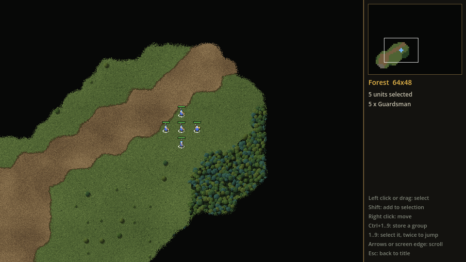
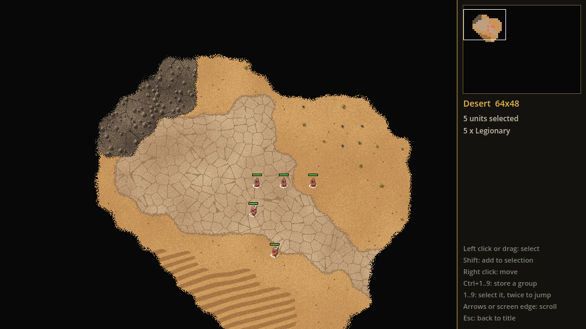

# Balance

Balance is an original single-player 2D real-time strategy game. It is a tribute
to Dune II in how it plays and how it looks: a flat, near top-down battlefield, a
grid, one scarce resource, small armies. Every name, faction, piece of art, piece
of music and level in this repository is original; nothing is taken from Dune II.

> Every faction claims to seek Balance, but each defines it differently.

**Status:** milestone M2 (Units) is done. From a placeholder title screen you
can open a forest map or a desert map and lead a squad of five infantry across
it. The map starts hidden and is revealed as the squad explores. There is no
combat yet. See [docs/roadmap.md](docs/roadmap.md).




## Controls

| Input | What it does |
| --- | --- |
| Left click | Select the unit under the mouse; click empty ground to deselect |
| Left drag | Select every unit in the box |
| Shift + click or drag | Add to the selection (Shift + click on a selected unit removes it) |
| Right click | Send the selected units there |
| Ctrl + 1 to 9 | Store the selection as a numbered group |
| 1 to 9 | Select that group; press twice quickly to jump the camera to it |
| Arrow keys, or mouse at a screen edge | Scroll the map |
| Click or drag on the minimap | Jump the camera |
| Esc | Back to the title screen |

Most names in the game ("Balance", "Orichalcum", the faction names, the mission
name) are provisional and may change.

## Open and run

You need Godot 4.7.2 (standard build, not .NET).

- **Editor:** start Godot, choose *Import*, pick `project.godot` in this folder,
  then press F5 to run.
- **Command line** (from the repo root, with the Godot executable on your path
  or written out in full):

  ```bash
  godot --path .
  ```

  To skip the title screen and open a map directly:

  ```bash
  godot --path . -- --map=forest
  ```

  ```bash
  godot --path . -- --map=desert
  ```

- **Tests** (headless; no window). Import the project once, then run the tests:

  ```bash
  godot --headless --path . --import
  ```

  ```bash
  godot --headless --path . --script res://tests/run_tests.gd
  ```

  The runner prints `TESTS PASSED` and exits with code 0 when every test passes.
  A test file is `tests/test_*.gd`; every method in it whose name starts with
  `test_` is a test.

The first time the project is opened Godot creates a `.godot/` cache folder. It
is ignored by git.

The game renders at 960x540 and is scaled up by whole numbers only (x2 fills a
1920x1080 window), so pixels stay square and sharp.

## Tools

| Tool | Version | Used for |
| --- | --- | --- |
| Godot | 4.7.2 stable | Engine and editor; game code is GDScript |
| Blender | 5.2 | Rendering unit and building sprites |
| Krita | any recent | Hand-painting and touching up art |
| Python | 3.14 with Pillow and numpy | Asset pipeline scripts and the mockup generators |
| git, GitHub CLI | any recent | Version control |

## Folders

| Folder | What it holds |
| --- | --- |
| `scenes/` | Godot scenes (`.tscn`). `main.tscn` is the scene the game starts in; `map_view.tscn` is the in-game screen. |
| `scripts/` | GDScript code. |
| `scripts/sim/` | The game simulation: grid, units, orders, combat, economy. No drawing or input code. So far: terrain, maps, units, move orders, pathfinding and shroud. |
| `scripts/ui/` | Screens, HUD, input handling and anything else the player sees or clicks. So far: title screen, terrain, unit and shroud drawing, selection and orders, camera, minimap. |
| `data/` | Unit, building and terrain definitions, stored as Godot `Resource` files. So far: `terrain/` (one file per terrain type), `biomes/` (which terrain types belong together, in drawing order), `maps/` and `units/` (one file per unit type). |
| `assets/sprites/` | Unit, building and effect sprites. `units/` holds the unit sprite sheets, generated by `tools/render_units.py` and `tools/make_units.py`. |
| `assets/tiles/` | Terrain tiles, one folder per biome. Generated by `tools/make_tiles.py`; do not edit by hand. |
| `assets/ui/` | HUD and menu art, fonts. |
| `assets/audio/` | Sound effects and music. |
| `tools/` | Asset pipeline scripts (Blender and Python) that produce the files in `assets/` and the maps in `data/maps/`. Not loaded by Godot. |
| `tests/` | Headless tests, run from the command line. |
| `docs/` | Design, visual style, terrain and roadmap documents, and screenshots. Not loaded by Godot. |
| `mockups/` | Style mockups and the scripts that generated them. Reference material only, not game code or game art. Not loaded by Godot. |

`docs/`, `tools/` and `mockups/` each contain an empty `.gdignore` file, which
tells Godot to skip the folder. Empty folders hold a `.gitkeep` file so git keeps
them; delete it once the folder has real content.

## Asset pipeline

Terrain tiles, the shroud tiles and the two maps are generated by Python scripts
(Pillow and numpy needed). They use fixed seeds, so running them again gives the
same files.

```bash
python tools/make_tiles.py
```

```bash
python tools/make_maps.py
```

Unit sprites are made in two steps: Blender renders each unit from eight sides
into a scratch folder, then a Python script shrinks the renders and packs them
into sprite sheets.

```bash
C:\Blender\blender.exe -b --factory-startup -P tools/render_units.py -- tools/_raw
```

```bash
python tools/make_units.py
```

After regenerating, open the project in Godot (or run the `--import` command
above) so Godot picks up the changed images. How the terrain is defined and drawn
is explained in [docs/terrain.md](docs/terrain.md); units, orders and the shroud
in [docs/units.md](docs/units.md).

## Documents

- [docs/design.md](docs/design.md): design pillars, factions, backstory, heroes, Mission 1, open questions.
- [docs/visual-style.md](docs/visual-style.md): the approved look, with reference mockups.
- [docs/terrain.md](docs/terrain.md): terrain types, maps, and how the map is drawn.
- [docs/units.md](docs/units.md): units, the simulation tick, move orders, pathfinding, shroud, controls.
- [docs/roadmap.md](docs/roadmap.md): milestones M0 to M10 and what "done" means for each.

## Roadmap in short

Each milestone ends in something playable and a push to this repository.

| Milestone | What it adds |
| --- | --- |
| M0 Setup | Repository, Godot project, docs. **Done.** |
| M1 Map | Terrain, camera scrolling, minimap. **Done.** |
| M2 Units | Selection, orders, pathfinding, shroud. **Done.** |
| M3 Combat | Combat and the control-point rule: a playable Mission 1. |
| M4 Economy | Harvester, refinery, storage. |
| M5 Base | Base building and production. |
| M6 Enemy AI | A computer opponent. |
| M7 Vertical slice | One complete, representative mission. |
| M8 Content | The rest of the units, buildings and terrain. |
| M9 Campaign | The Blue and Red campaigns. |
| M10 Polish | Final art, audio, balance and bug fixing. |

Multiplayer is out of scope.
